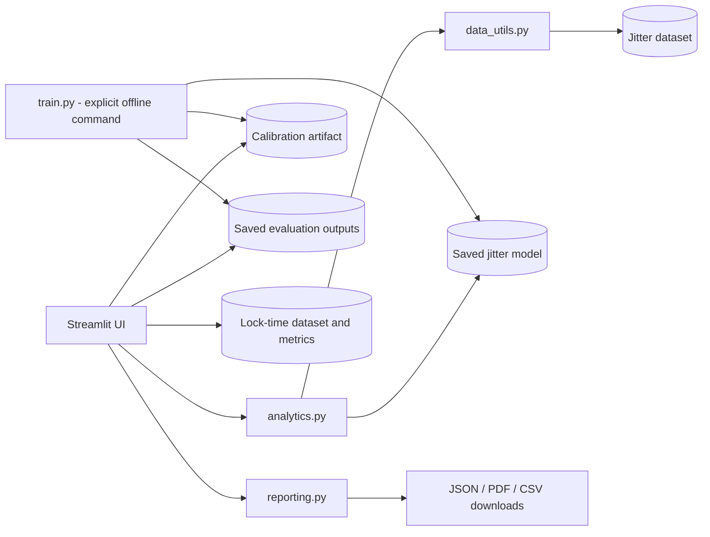

# PLL-Smart 2.1

## PLL-Smart: AI-Powered Adaptive PLL Test-Time Optimization & Engineering Analytics

PLL-Smart is a Streamlit research prototype for exploring RMS jitter prediction
and adaptive PLL lock-time calculations. It combines a saved
`HistGradientBoostingRegressor`, a separate split-conformal calibration guard
band, dataset validation, batch/manual predictions, drift indicators,
explainability, what-if analysis, prediction history, and downloadable
engineering reports.

> **Synthetic-data research prototype only.** It is not production-qualified.
> The saved illustrative retrospective evaluation identified **52 measured
> failing dies among 96,121 illustrative skip candidates**. The app centrally
> inhibits skip recommendations and always recommends **RUN FULL JITTER TEST**.
> It does not claim a DPPM guarantee.

## Problem statement

PLL production tests can spend time waiting for loop lock and measuring jitter.
This project demonstrates two separate analysis ideas:

1. Predict RMS jitter from seven pre-test parametric features and calculate an
   upper prediction bound using calibration-only residuals.
2. Compare a fixed lock-time wait against an illustrative per-die adaptive
   wait: `min(lock_time_us + 3.0, 60.0)`.

The analyses are educational demonstrations. They do not authorize omitting
production tests or changing test programs.

## Main features

- Dark engineering dashboard with 12 sections: executive overview, dataset
  explorer, batch prediction, manual prediction, actual-vs-predicted analysis,
  adaptive lock-time, model performance, drift monitoring, session history,
  reports/recommendations, Explainable AI, and engineering what-if.
- CSV validation for required features, missing and invalid values, duplicate
  rows, and training-range violations.
- Batch and manual inference from the saved model; uploads never retrain it.
- Optional measured-jitter comparisons, kept separate from model inputs.
- Calibration upper bound, range checks, conservative explanations, and
  formula-safe CSV exports.
- Session-only history and JSON, PDF, and CSV engineering report downloads
  generated from a common report snapshot.
- Adaptive lock-time calculation and comparison with the saved source data.

## Architecture



### Project modules

- `app.py` — Streamlit dashboard, cached artifact loading, UI, and report
  downloads.
- `analytics.py` — upload validation, batch scoring, comparisons, drift,
  model-based explanations, what-if analysis, and session history.
- `data_utils.py` — feature contract, original partition loader, safety
  validation, calibration helper, and lock-time formula.
- `reporting.py` — in-memory report serializers for JSON, PDF, and CSV.
- `train.py` — explicit training/calibration/evaluation workflow. It is not
  invoked by the dashboard and may overwrite saved model/evaluation artifacts
  if run with its default paths.
- `data/generate_synthetic_pll_data.py` — auxiliary synthetic illustration
  figure generator; it is not needed to run the dashboard.
- `tests/` — pipeline, safety, analytics, and report-export regression tests.

## Machine-learning workflow

1. Load the supplied jitter CSV and retain its original `train` (60,000),
   `calibration` (40,000), and `test` (100,000) split labels without reshuffling.
2. Use only `vco_band_code`, `ring_osc_ghz`, `chargepump_ua`,
   `lock_time_us`, `vdd_droop_norm`, `wafer_radius_norm`, and
   `leak_screen_norm` as model features.
3. Fit the saved HistGradientBoosting regressor on training rows.
4. Calculate the one-sided upper residual guard band on calibration rows.
5. Evaluate once on the held-out test partition. One negative lock-time record
   is invalid, so the saved test evaluation contains 99,999 usable rows.
6. On dashboard upload, validate and score eligible rows without fitting or
   calibrating from uploads. Actual jitter columns and synthetic target labels
   are not model inputs.

Feature importance and per-record feature replacement effects are
model-dependent, non-causal explanations. The conformal guard band is not a
production uncertainty guarantee; the split is a random-die split, not a
lot-held-out qualification.

## Dataset description

| File | Contents | Publication/runtime role |
|---|---|---|
| `data/synthetic_pll_jitter_dataset.csv` | 200,000 synthetic rows; seven model features plus identifiers, target/labels, and original split annotations. | Required by current dashboard for training-range reference, dataset exploration, and reference analysis. |
| `data/synthetic_pll_locktime_dataset.csv` | 20,000 synthetic lock-time records. | Required by current dashboard for lock-time analysis. |

The full jitter file is about **16.28 MiB** and the lock-time file about
**0.46 MiB**. The application currently loads the full jitter dataset, so
replacing it with a small demo sample would prevent the committed model ranges,
dataset explorer, and original analyses from matching. Keep the synthetic
dataset clearly labelled; do not substitute real or customer data.

## Model performance

Saved original evaluation (`outputs/jitter_metrics.json`):

| Metric | Held-out synthetic test result |
|---|---:|
| MAE | 0.057078 ps |
| RMSE | 0.079667 ps |
| R² | 0.849857 |
| Usable test rows | 99,999 |
| Calibration guard band | 0.148626 ps |
| Illustrative skip candidates | 96,121 |
| Measured failures among candidates | **52** |

Saved lock-time analysis (`outputs/locktime_metrics.json`) reports mean fixed
wait of 60.0 µs, mean adaptive wait of 17.5493 µs, and illustrative average
reduction of 70.7511%. These are dataset calculations, not production
qualification results.

## Safety restrictions

- A global safety inhibit is enforced in the low-level decision helper.
- Missing, invalid, out-of-range, or uncertain inputs default to
  **RUN FULL JITTER TEST**.
- Batch, manual, explanation, what-if, and report flows do not authorize
  skipping the jitter test.
- `rms_jitter_ps`, `actual_jitter_ps`, `jitter_fail`, `defect_injected`,
  identifiers, split labels, and limit columns are not inference features.
- The illustrative 2.2 ps USL, leakage screen threshold 2.0, 3 µs wait margin,
  60 µs wait cap, and 5% calibration alpha are not approved production limits.
- No production qualification, safety guarantee, or DPPM guarantee is claimed.

## Installation and local use

Tested with 64-bit CPython **3.13.14**. From the project root on Windows:

```powershell
py -3.13 -m venv .venv
.\.venv\Scripts\python.exe -m pip install -r requirements.txt
.\.venv\Scripts\python.exe -m streamlit run app.py
```

Open the local URL printed by Streamlit. For PowerShell activation:

```powershell
.\.venv\Scripts\Activate.ps1
python -m streamlit run app.py
```

Run tests and compilation checks:

```powershell
.\.venv\Scripts\python.exe -m pytest -q
.\.venv\Scripts\python.exe -m py_compile app.py analytics.py data_utils.py train.py reporting.py
```

The requirements pin tested dependency versions. The auxiliary
`generate_synthetic_pll_data.py` uses Matplotlib, included in the requirements,
but running that generator is not necessary for the dashboard. Do not run
`train.py` on the publication copy unless you intentionally want to regenerate
and replace the saved model/evaluation artifacts.

## Deployment

For Streamlit Community Cloud or another Streamlit host:

1. Publish the project root with `app.py` as the entry point.
2. Select a 64-bit Python 3.13 runtime and install from `requirements.txt`.
3. Include all runtime files in the manifest below; the app reads the saved
   model, calibration, evaluation outputs, and both datasets using paths
   relative to the project root.
4. No secrets or external database are required for the basic demo. Configure
   any future credentials through the host's secret manager, never in source.
5. Verify the deployment with representative uploaded data and keep the full
   jitter test enabled.

The app loads the full 200,000-row jitter CSV and saved test predictions into
memory; choose a host with sufficient memory and allow for initial load time.
Do not expose a production test-control interface based on this prototype.

## Screenshots

No screenshots are currently included. Add reviewed dashboard captures under
`docs/screenshots/` before publication if desired. Ensure captures contain no
private data or credentials and retain the synthetic-data disclaimer.

## Proposed GitHub file manifest

### Include

| Path | Reason |
|---|---|
| `.gitignore`, `.streamlit/config.toml` | Ignore local files and provide dashboard theme. |
| `README.md`, `requirements.txt` | Project documentation and pinned dependencies. |
| `app.py`, `analytics.py`, `data_utils.py`, `reporting.py`, `train.py` | Application and explicit offline workflow. |
| `tests/` | Regression and safety tests. |
| `data/synthetic_pll_jitter_dataset.csv`, `data/synthetic_pll_locktime_dataset.csv` | Required synthetic runtime datasets. |
| `data/generate_synthetic_pll_data.py` | Auxiliary synthetic figure generator. |
| `models/jitter_model.joblib` (about 0.64 MiB), `models/jitter_calibration.json` | The joblib contains the inference model, feature ranges, guard band, and decision parameters used by the app. The JSON sidecar is retained for human-readable calibration provenance; current app startup does not load it directly. |
| `outputs/jitter_metrics.json`, `outputs/locktime_metrics.json`, `outputs/test_predictions.csv` (about 8.36 MiB) | Saved evaluation material loaded by the dashboard. |

All listed individual data/model/evaluation files are below GitHub's 50 MiB
large-file warning threshold and 100 MiB per-file hard limit. Their combined
size is modest for a demo repository, although the full jitter dataset and
test-prediction file contribute most of the download size.

### Exclude

- `.venv/`, `venv/`, `env/`, Python bytecode/cache directories, `.pytest_cache/`,
  coverage output, editor backups, temporary files, and logs.
- `.env*`, `.streamlit/secrets.toml`, and any local credentials.
- Generated engineering report downloads, temporary report files, and
  generator output figures/statistics.
- Other dataset exports and unrecognized model/output files; `.gitignore`
  allowlists only the runtime data and artifacts above.
- Empty duplicate files `README.md.txt` and `requirements.txt.txt`.
- `AI_Optimized_PLL_Test_Time_Reduction.pdf`: not required at runtime; its
  distribution rights/proprietary status need confirmation before publication.

The current workspace is not a Git repository, so this is a proposed
publication manifest rather than a verified Git index/status listing. Review
rights and provenance for all supplied datasets and artifacts before pushing.

## License

No license is included. Ownership and redistribution rights for the supplied
source materials have not been established here; do not imply permission to
reuse or redistribute them. Confirm project/data/model ownership before
choosing a license or publishing.

## Limitations and future enhancements

- Synthetic data does not represent production variation or all defect modes.
- The observed failing candidate dies prohibit skip authorization; full
  testing remains enabled.
- Random-die evaluation can overstate generalization compared with
  lot-held-out evaluation.
- Session prediction history is not persistent across sessions.
- Drift statistics are triage warnings, not proof of failure or safety.
- No wafer map is shown because validated spatial coordinate and wafer
  identity data are not supplied.

Potential future work, subject to new representative data and formal safety
review: lot/tester-held-out validation, persistent audited history,
versioned model metadata, validated production schema mappings, approved
limits, and quality-controlled shadow-mode monitoring.
